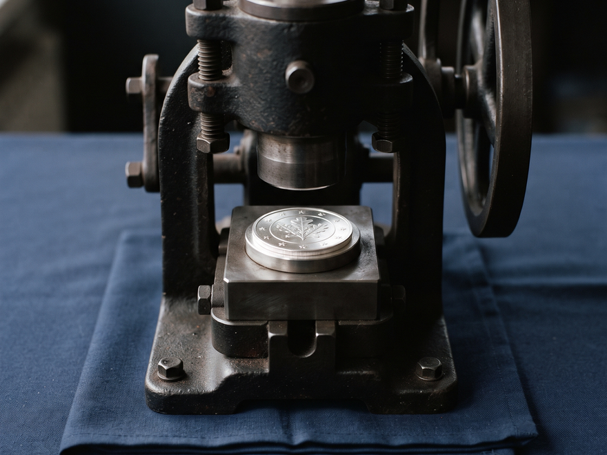

# analyze-file-hasher

# analyze-file-hasher
A tool to calculate and compare cryptographic hashes (e.g., SHA256, MD5) of files for integrity verification. - Focused on Data analysis and reporting

## Install
`git clone https://github.com/ShadowStrikeHQ/analyze-file-hasher`

## Usage
`./analyze-file-hasher [params]`

## Parameters
- `-h`: Show help message and exit
- `-f1`: Path to the first file
- `-f2`: Path to the second file, required for 
- `-d`: Path to the directory, required for 
- `-a`: No description provided

## License
Copyright (c) ShadowStrikeHQ

> Margin note: the parameter lines for -f2 and -d both end mid phrase at the words required for, and -a is listed with no description provided. Those three gaps are left as gaps here, with nothing supplied to fill them, exactly as the source leaves them.
